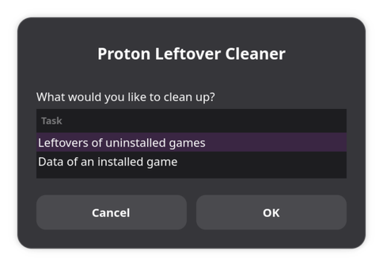
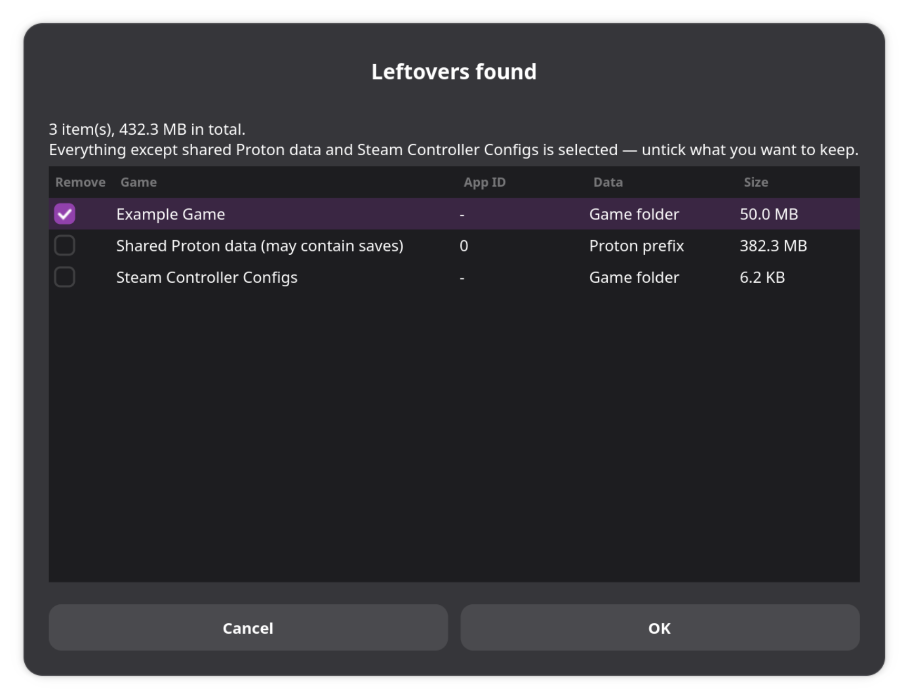
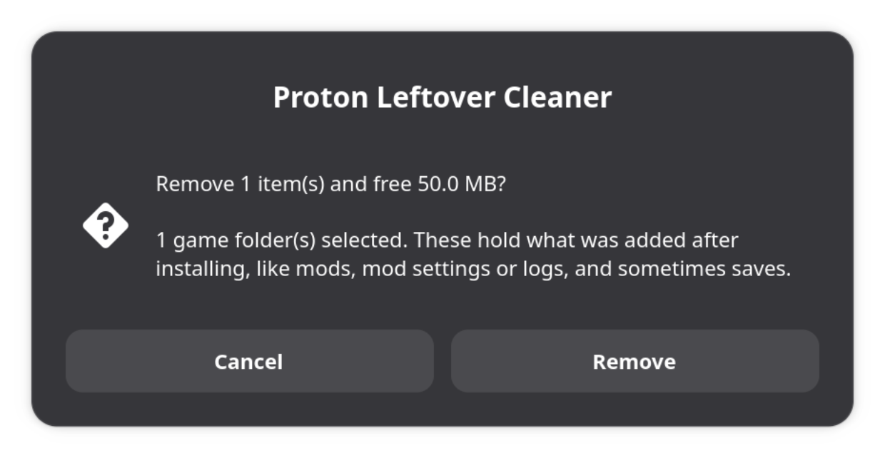
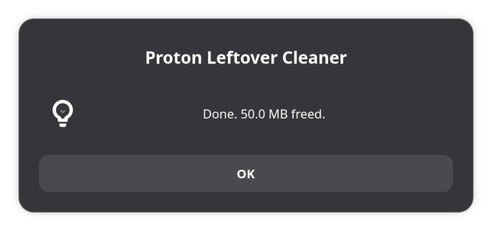

# Proton Leftover Cleaner

[](https://github.com/vold-source/Proton-Leftover-Cleaner/releases/latest)
[](https://github.com/vold-source/Proton-Leftover-Cleaner/actions/workflows/release.yml)
[](LICENSE)

Finds and removes the Proton prefixes, shader caches and game folders that Steam leaves behind on Linux after you uninstall a game.

- **Shows what it found first:** every leftover is listed with the game's name, what kind of data it is and how big it is. Nothing is removed until you confirm.
- **Careful with saves:** anything that might hold save files is clearly marked, and the riskiest items start unticked.
- **Works with every library:** internal drives, external drives, SD cards and custom folders, with regular and Flatpak Steam.
- **Made for SteamOS, Bazzite and other immutable distros:** a single AppImage, nothing to install into the system.

x86_64 only. Works offline; nothing is sent anywhere.



## Why there are leftovers

When Steam runs a Windows game through Proton, it creates two folders for that game:

- a **Proton prefix** (`steamapps/compatdata/<App ID>`): the game's own little Windows installation, with its settings and often its save files
- a **shader cache** (`steamapps/shadercache/<App ID>`): precompiled graphics shaders

Uninstalling a game often leaves both behind, and sometimes part of its install folder too (`steamapps/common/<game>`): Steam only deletes the files it downloaded, so mods, mod settings, logs and caches created later stay there. Over time this can add up to many gigabytes.

## Install

1. Download the latest `Proton_Leftover_Cleaner-*-x86_64.AppImage` from [Releases](https://github.com/vold-source/Proton-Leftover-Cleaner/releases/latest).
2. Install it with **[AppManager](https://github.com/kem-a/AppManager)** (recommended): double-click the AppImage and drag it to install. Proton Leftover Cleaner then appears in your app menu.
3. Open it from your app menu.

[Gear Lever](https://github.com/mijorus/gearlever) works as well. Without an AppImage manager, make the file executable (right-click → Properties → Permissions → "Is executable") and double-click it.

To check the download, put the matching `.sha256` file next to it and run:

```sh
sha256sum -c Proton_Leftover_Cleaner-*-x86_64.AppImage.sha256
```

### Plain script

You can also skip the AppImage and run the script directly:

```sh
chmod +x proton-leftover-cleaner.sh
./proton-leftover-cleaner.sh
```

### Requirements

- **zenity** for the windows (preinstalled on most desktops, including SteamOS and Bazzite)
- **python3** for game names and for recognising non-Steam games (also usually preinstalled). Without it, leftovers are shown by App ID only and non-Steam game data is left alone.

## Usage

Start the app and choose one of two things.

### Leftovers of uninstalled games

The app scans your libraries and lists what it found. Untick anything you want to keep and click OK.



Before anything is removed, you see how much space will be freed, plus a note about anything that might hold mods or saves:



Once it's done, the app tells you how much space was freed:



| What's listed | Starts | Notes |
|---|---|---|
| Proton prefix of an uninstalled game | ticked | May contain saves that aren't in Steam Cloud |
| Shader cache of an uninstalled game | ticked | Always safe; Steam rebuilds it when needed |
| Game folder (`steamapps/common`) no installed game uses | ticked | Usually mods, logs or caches, occasionally saves |
| Data of a non-Steam game you removed from Steam | ticked | Non-Steam games still in your library are never touched |
| Shared Proton data (`compatdata/0`) | unticked | Non-Steam games can keep their saves here |
| Steam Controller Configs | unticked | Steam's own controller layouts |

### Data of an installed game

Pick a game, then remove its shader cache, its Proton prefix, or both. Useful when a game stopped starting. Steam recreates them on the next launch.

## Commands

| Command | What it does |
|---|---|
| `proton-leftover-cleaner.sh` | Open the app |
| `proton-leftover-cleaner.sh --list` | List leftovers in the terminal, delete nothing |
| `proton-leftover-cleaner.sh --version` | Show the version |
| `proton-leftover-cleaner.sh --help` | Show the help |

The AppImage accepts the same options.

## Please note

- **Removal is permanent:** removed folders are deleted right away, not moved to the trash. There's no undo.
- **Save files:** many games store their saves inside the Proton prefix. Removing it deletes saves that aren't synced with Steam Cloud. Back them up first if you're unsure.
- **Non-Steam games installed inside their prefix:** removing such a leftover removes the game files as well.
- **Game folders** can hold mods or their settings you may want to keep for a reinstall, and a few games keep saves there.
- **Steam running:** before resetting the data of an installed game, the app warns you if Steam is running. Close the game first.

## Updates

AppManager (or Gear Lever) checks this repository and installs new versions for you.

Version numbers work like this: the last number goes up for fixes (1.1.0 → 1.1.1), the middle one for new features (1.1 → 1.2), and the first one for changes that work differently from before (1.x → 2.0). What changed in each version is on the [Releases](https://github.com/vold-source/Proton-Leftover-Cleaner/releases) page.

## Troubleshooting

- **"zenity is needed":** install zenity, or use `--list` in a terminal to see the leftovers without the windows.
- **Games show only a number:** python3 is missing, so the app can't read game names from Steam's cache. Leftovers can still be removed.
- **An installed game shows up as a leftover:** its library is probably on a drive that isn't connected. The app warns you about this before scanning; plug the drive in and scan again.
- **Something else:** please [open an issue](https://github.com/vold-source/Proton-Leftover-Cleaner/issues).

## How it's built

The whole app is one bash script, [`proton-leftover-cleaner.sh`](proton-leftover-cleaner.sh), with comments explaining each part. [`packaging/appimage/build.sh`](packaging/appimage/build.sh) wraps it into an AppImage with [appimagetool](https://github.com/AppImage/appimagetool), and the [release workflow](.github/workflows/release.yml) builds and publishes each new version.

To build locally:

```sh
bash packaging/appimage/build.sh   # → build/Proton_Leftover_Cleaner-<version>-x86_64.AppImage
```

The `build` folder also gets a `.sha256` checksum and a `.zsync` file (used by AppImage updaters). The version number comes from `APP_VERSION` in the script.

## License

Public domain, via [The Unlicense](LICENSE). Use it, change it and share it however you like.
